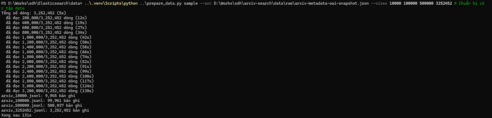

# Report

## Context

Context 1: Máy chạy benchmark

Máy host

- CPU: AMD Ryzen 5 7500F, 6 nhân/12 luồng
- RAM: 32 GB, WSL 20 GB, swap 8 GB
- Docker: Engine 29.9.3, Compose 5.7.0
- Client: Python 3.12.10, elasticsearch-py 8.15.1, psycopg2 2.9.13

Container

- Elasticsearch 8.15.3: 4 CPU, 6 GB RAM (heap 2 GB), 1 node, mỗi index 1 shard / 0 replica
- PostgreSQL 16.16 + pg_search 0.26.7 (image ParadeDB): 4 CPU, 6 GB RAM, shared_buffers 1,5 GB (25% RAM), effective_cache_size 4 GB, work_mem 32 MB, maintenance_work_mem 1 GB

Khi nạp và khi đo chỉ bật một hệ thống, hệ thống còn lại tắt để không tranh CPU/RAM.

## Data source

- Nguồn dữ liệu: Kaggle Cornell-University/arxiv, version 312 (cập nhật 15/11/2026), file 5.707.139.903 byte, 3.252.452 dòng.

Chuẩn bị tập data mẫu: từ data source tách thành các tập 10k, 100k, 500k và full (toàn bộ). Mỗi bài tính `u = crc32(id) / 2^32`, một số trong [0, 1) chỉ phụ thuộc vào id; bài thuộc tập n nếu `u < n / 3.252.452`. Nhờ vậy chạy trên máy nào cũng ra đúng cùng các tập, và các tập lồng nhau (10k ⊂ 100k ⊂ 500k ⊂ full). Cỡ tập chỉ xấp xỉ n (vd. 9.945 thay vì 10.000) vì bài được chọn theo ngưỡng chứ không cắt đúng n dòng.



**Nạp vào Elasticsearch**

```bash
docker compose --profile baseline stop postgres
docker compose up -d elasticsearch
# n = 10000 | 100000 | 500000 | 3252452  ->  size = 10k | 100k | 500k | full
python prepare_data.py index --file data/arxiv_<n>.jsonl --index arxiv_<size> --recreate
```

Thời gian nạp mỗi size

- Đã nạp 9,945 bản ghi trong 3.1s (3,204 bản ghi/s), lỗi: 0
- Đã nạp 99,961 bản ghi trong 17.9s (5,572 bản ghi/s), lỗi: 0
- Đã nạp 500,037 bản ghi trong 62.6s (7,988 bản ghi/s), lỗi: 0
- Đã nạp 3,252,452 bản ghi trong 444.0s (7,325 bản ghi/s), lỗi: 0

Kết quả tạo ra được 4 indices

```bash
curl.exe -s "http://127.0.0.1:9200/_cat/indices/arxiv_*?v&h=index,docs.count,store.size,segments.count&s=index"
index      docs.count store.size segments.count
arxiv_100k      99961    108.7mb              1
arxiv_10k        9945     11.3mb              1
arxiv_500k     500031    536.5mb              3
arxiv_full    3252359      3.3gb             22
```

`docs.deleted`: arxiv_500k = 6, arxiv_full = 93 (bằng số dòng trùng id trong file).

**Nạp vào PostgreSQL**

```bash
docker compose stop elasticsearch
docker compose --profile baseline up -d postgres
python load_postgres.py --file data/arxiv_<n>.jsonl --table papers_<size>
```

Mỗi mức dữ liệu là một bảng `papers_<size>`. Script nạp bằng `COPY`, dựng hai chỉ mục full-text, chạy `VACUUM ANALYZE`, rồi ghi thời gian và dung lượng vào `results/pg_loading.csv`. Với id trùng, script giữ bản xuất hiện sau, giống ES ghi đè theo `_id`, nên hai bên chứa cùng một tập bài (full: 3.252.359 bài).

*Các phương án truy vấn được so sánh*

| Mã | Chỉ mục | Cách khớp | Xếp hạng |
|---|---|---|---|
| `pg_fts_and` | GIN trên cột `tsv` | phải có mọi từ (AND) | `ts_rank_cd`, title nặng gấp 3 abstract |
| `pg_fts_or` | GIN trên cột `tsv` | có ít nhất một từ (OR), cùng luật khớp với ES | như trên |
| `pg_bm25` | ParadeDB (`pg_search`) | OR, `disjunction_max(title^3, abstract)`, tương đương `multi_match` của ES | BM25 (k1 = 1,2; b = 0,75) |

Cột `tsv` ghép title (trọng số A) và abstract (trọng số B) sau bộ phân tích `english` của PG (tách từ, bỏ stopword, đưa về gốc từ). Chỉ mục ParadeDB dùng tokenizer `unicode_words` kèm stemmer và stopwords tiếng Anh. Cả hai cách xử lý văn bản đều gần với analyzer `english` mà ES dùng cho title và abstract.

- **GIN**: chỉ mục đảo ngược (inverted index) có sẵn của PostgreSQL, là loại chỉ mục docs khuyên dùng cho full-text search. Mỗi từ trỏ tới danh sách vị trí dòng trong bảng, nên chỉ mục chỉ trả lời được "dòng nào khớp". Xếp hạng nằm ngoài chỉ mục: PG đọc lại tsvector của từng dòng khớp để tính `ts_rank_cd`, và hàm này không dùng thống kê toàn kho (IDF).
- **ParadeDB BM25**: chỉ mục của extension `pg_search`, lõi là Tantivy (thư viện tìm kiếm viết bằng Rust, mô phỏng Lucene). Đây cũng là chỉ mục đảo ngược, nhưng chia thành các segment như Lucene và lưu thêm tần suất từ, độ dài trường, nên tính được điểm BM25 và lấy top-K ngay trong chỉ mục.

*Lý do chọn*

- **Không dùng `LIKE`**: `LIKE '%từ%'` không dùng được chỉ mục B-tree (B-tree chỉ dùng được khi mẫu neo ở đầu chuỗi) nên phải quét toàn bảng. Nó cũng không tách từ, không đưa về gốc từ, không xếp hạng. So ES với `LIKE` chỉ cho một kết quả hiển nhiên. Code vẫn giữ `pg_like` để tham chiếu.
- **PG-FTS (GIN)**: cách làm full-text search có sẵn của PostgreSQL, không cần cài thêm, đại diện cho phương án "dùng luôn CSDL đang có". Đo cả AND (cách viết thường gặp) lẫn OR (cùng luật khớp với ES).
- **PG-BM25 (ParadeDB)**: cùng mô hình xếp hạng (BM25) và cùng kiểu cấu trúc chỉ mục với ES. Như vậy, so với ES là so "cùng thuật toán, khác hệ thống": một search engine chạy riêng và một search engine nhúng trong PostgreSQL.

*Kết quả nạp*

Thời gian (giây)

| Bảng | Số dòng | COPY | GIN | BM25 | VACUUM | Cộng các bước | Thực tế |
|---|---:|---:|---:|---:|---:|---:|---:|
| papers_10k | 9.945 | 1,88 | 0,46 | 0,95 | 0,28 | 3,6 | 4 |
| papers_100k | 99.961 | 17,11 | 5,85 | 4,16 | 0,56 | 27,7 | 28 |
| papers_500k | 500.031 | 81,16 | 24,30 | 20,76 | 1,08 | 127,3 | 128 |
| papers_full | 3.252.359 | 523,34 | 178,51 | 156,32 | 12,85 | 871,0 (14 ph 31 s) | 881 (14 ph 41 s) |
| Tổng | | | | | | 1.029,6 (17 ph 10 s) | 1.041 (17 ph 21 s) |

Dung lượng (MB)

| Bảng | Heap | GIN | BM25 | Tổng |
|---|---:|---:|---:|---:|
| papers_10k | 14,3 | 5,8 | 6,9 | 36,6 |
| papers_100k | 143,4 | 42,8 | 50,5 | 331,8 |
| papers_500k | 715,0 | 164,9 | 269,7 | 1.624,3 |
| papers_full | 4.649,8 | 777,9 | 1.744,3 | 10.256,2 |

- COPY đã gồm thời gian PG tính cột `tsv`. Cột "Thực tế" tính thêm lượt đọc file tìm id trùng và các lệnh tạo bảng, đếm dòng, đo dung lượng.
- "Tổng" dung lượng gồm heap, TOAST (giá trị dài được PG tách ra bảng phụ), khoá chính, GIN và BM25.
- Không so thẳng 871 s với 444 s của ES, vì PG dựng hai chỉ mục. Tính riêng cho `pg_bm25` (COPY + BM25 + VACUUM) là khoảng 692 s; cho `pg_fts` (COPY + GIN + VACUUM) là khoảng 715 s.
- Số liệu là của một lần đo. Lần này chậm hơn 19–38% so với một lần nạp thử trước đó trên cùng máy (ES chậm hơn 12%), nên thời gian nạp chỉ nên đọc theo bậc độ lớn.

Nguồn: PostgreSQL 16 Documentation, §11.2 *Index Types*, §12.3.3 *Ranking Search Results*, §12.9 *Preferred Index Types for Text Search*; ParadeDB docs 0.26.7, *Architecture*; S. Robertson & H. Zaragoza (2009), *The Probabilistic Relevance Framework: BM25 and Beyond*, Foundations and Trends in Information Retrieval 3(4).

## Đo truy vấn

Lượt đo chính (run2) chạy từ 00:29 đến 01:29 ngày 24/11, không có truy vấn nào timeout hay lỗi. Kết quả nằm trong thư mục `results/` (không đưa lên git; số liệu trong report được chép từ đây), bản chép để so sánh nằm ở `eval/` (có trong git, mô tả trong `eval/README.md`):

| File | Nội dung |
|---|---|
| `latency.csv` | Mỗi dòng là số tổng hợp của một tổ hợp (hệ thống, mức dữ liệu, pha, mức đồng thời): số request, p50/p95/p99, độ trễ trung bình, QPS, số timeout và lỗi, cấu hình lúc đo. Pha `cold` là lượt chạy đầu sau khi khởi động lại, `measure` là lượt đo chính. Riêng ES có thêm `es_took_p50_ms`, thời gian ES tự báo đã xử lý truy vấn. |
| `latency_raw.csv` | Từng request: hệ thống, mức dữ liệu, pha, mức đồng thời, lượt, mã truy vấn, độ trễ đo ở client, `took` của ES, trạng thái, số kết quả trả về. Các bảng tính lại theo từng câu (case 2, case 4) lấy từ file này. |
| `topk.csv` | Top-10 id bài của từng truy vấn ở pha `cold`, dùng cho case 5. |
| `matches.csv` | Số bài khớp của từng truy vấn theo hệ thống và mức dữ liệu, kèm thời gian đếm, dùng cho case 4. |
| `overlap.csv` | Với từng cặp hệ thống và từng truy vấn: RBO và tỉ lệ bài chung trong top-10, dùng cho case 5. |
| `latency_run1.csv` | Kết quả lượt đo trước (run1, 23/11, chỉ PG). |
| `summary_run2.md` | Các bảng tổng hợp sinh tự động từ những file trên. |
| `bench_run2.log` | Nhật ký lượt đo: thứ tự chạy, thời điểm và số đo của từng bước. |

**Case 1: Độ trễ và thông lượng theo kích thước dữ liệu**

Câu hỏi: khi dữ liệu tăng từ 10k lên full (gấp 327 lần), mỗi truy vấn chậm đi bao nhiêu và mỗi hệ thống phục vụ được bao nhiêu truy vấn mỗi giây?

*Lý do chọn độ đo*

- Độ trễ là thứ người dùng cảm nhận trực tiếp mỗi lần tìm kiếm; thông lượng (QPS) cho biết hệ thống phục vụ được bao nhiêu người dùng cùng lúc. Đây là hai đại lượng cơ bản khi so hiệu năng hai hệ thống tìm kiếm.
- Độ trễ được báo bằng percentile (p50, p95) thay vì trung bình, vì phân bố độ trễ lệch: vài câu rất chậm kéo trung bình lên cao hơn hẳn trường hợp điển hình. Ví dụ `pg_fts_and` ở mức full có p50 28 ms nhưng trung bình 505 ms.
- Đo ở 4 mức dữ liệu để thấy mỗi hệ thống mở rộng ra sao khi dữ liệu lớn dần; đo ở 3 mức đồng thời để thấy hệ thống bão hoà từ lúc nào.

*Ý nghĩa độ đo*

- **Độ trễ**: thời gian từ lúc client gửi truy vấn đến lúc nhận đủ 10 kết quả, đo phía client, nên gồm cả mạng nội bộ, giao thức (HTTP với ES, giao thức PG) và xử lý ở client Python.
- **p50 / p95**: xếp độ trễ của mọi request từ nhanh đến chậm. p50 (trung vị) là giá trị đứng giữa: 50% request nhanh hơn. p95 là giá trị mà 95% request nhanh hơn, chỉ 5% chậm hơn. p50 và p95 gần nhau nghĩa là thời gian trả lời đều; p95 lớn hơn p50 nhiều lần nghĩa là có những câu làm hệ thống chậm hẳn.
- **Mức đồng thời**: số luồng client cùng gửi truy vấn, mỗi luồng gửi câu tiếp ngay khi câu trước trả về (closed-loop). Đồng thời 1 cho thời gian xử lý một câu khi không có tranh chấp; đồng thời 4 và 16 cho thấy hệ thống chịu tải ra sao.
- **QPS**: số truy vấn hoàn thành mỗi giây. Khi luôn có c truy vấn đang chạy, QPS ≈ c / độ trễ trung bình (định luật Little). Hệ quả: QPS phụ thuộc vào độ trễ trung bình chứ không phải p50, và nếu tăng c mà QPS không tăng thì độ trễ phải tăng theo, tức request đang đứng xếp hàng. Vì client chỉ gửi câu mới khi câu cũ xong, QPS ở đây là thông lượng tại một mức đồng thời cố định, không phải tải tối đa hệ thống chịu được.

*Cách thực hiện*

- Bộ truy vấn: 200 truy vấn (G0001–G0200), mỗi truy vấn là 2–4 từ nội dung liên tiếp cắt từ title của một bài ngẫu nhiên trong tập 10k (seed 42, chạy lại ra đúng file cũ). Ví dụ: G0001 `gluon contribution open heavy-meson`, G0034 `potential large language`, G0106 `filtervit dropoutvit`. Vì 10k nằm trong mọi tập lớn hơn, truy vấn nào cũng có ít nhất một bài khớp ở mọi mức.
- Với mỗi cặp (hệ thống, mức dữ liệu): dừng container, xả page cache của VM Docker, khởi động lại, chạy một lượt 200 câu tuần tự (pha `cold`, dùng cho case 3 và 5). Sau đó ở mỗi mức đồng thời 1, 4, 16 chạy 200 câu × 3 lượt = 600 request.
- p50/p95 tính trên 600 request đó. QPS của một lượt = 200 / thời gian của cả lượt, lấy trung vị của 3 lượt.
- Kết nối tới ES/PG được mở sẵn trước khi bấm giờ. ES tắt request cache. Timeout 30 s mỗi truy vấn.
- Ngoại lệ: `pg_fts_or` ở mức full mất khoảng 8 s mỗi câu, nên chỉ chạy 50 câu đầu (G0001–G0050), 1 lượt, đồng thời 1 và 4.

*Kết quả*

Độ trễ p50 / p95 (ms), đồng thời 1

| Hệ thống | 10k | 100k | 500k | full |
|---|---:|---:|---:|---:|
| es | 3,1 / 4,4 | 3,5 / 4,9 | 3,5 / 5,0 | 5,8 / 8,5 |
| pg_bm25 | 1,6 / 2,0 | 2,3 / 3,1 | 3,1 / 5,2 | 10,0 / 14,4 |
| pg_fts_and | 0,7 / 1,1 | 1,0 / 4,2 | 1,8 / 18,2 | 28,1 / 2.207 |
| pg_fts_or | 5,1 / 26,4 | 45,3 / 227,5 | 224,2 / 479,8 | 7.838 / 14.936 (50 câu) |

QPS ở đồng thời 1 / 4 / 16

| Hệ thống | 10k | 100k | 500k | full |
|---|---:|---:|---:|---:|
| es | 330 / 1.104 / 1.113 | 289 / 940 / 1.042 | 285 / 712 / 939 | 173 / 396 / 436 |
| pg_bm25 | 631 / 2.352 / 4.203 | 419 / 1.694 / 1.758 | 293 / 1.160 / 924 | 108 / 187 / 220 |
| pg_fts_and | 1.266 / 4.623 / 8.838 | 583 / 2.083 / 2.407 | 176 / 581 / 534 | 2,0 / 4,6 / 6,9 |
| pg_fts_or | 96 / 404 / 293 | 11,9 / 41,7 / 29,4 | 4,1 / 6,2 / 5,0 | 0,1 / 0,4 / – |

*Giải thích kết quả*

1. **ES và `pg_bm25` gần như không chậm đi khi dữ liệu tăng, FTS thì chậm đi rất nhiều.** Dữ liệu gấp 327 lần, nhưng p50 của ES chỉ tăng 1,9 lần và `pg_bm25` 6,4 lần. Hai hệ này lấy thẳng 10 bài điểm cao nhất từ chỉ mục. FTS phải đọc lại từng bài khớp để chấm điểm, nên càng nhiều bài khớp càng chậm: `pg_fts_and` tăng 40 lần, `pg_fts_or` khoảng 1.500 lần (case 4).
2. **Dữ liệu nhỏ thì PG nhanh hơn, dữ liệu lớn thì ES nhanh hơn.** Mỗi request tới ES tốn sẵn khoảng 2 ms cho HTTP, JSON và client Python (đo bằng độ trễ client trừ `took`). Với PG, phần này dưới 0,7 ms. Ở 10k, việc tìm kiếm rất nhẹ nên phần chi phí cố định này quyết định, và `pg_bm25` thắng (1,6 so với 3,1 ms). Ở full, việc tìm kiếm nặng dần lên và ES làm phần này nhanh hơn, nên ES thắng (5,8 so với 10,0 ms).
3. **`pg_fts_and` thường nhanh nhưng có câu rất chậm.** Ở full, một nửa số câu xong trong 28 ms, nhưng 5% câu chậm nhất mất trên 2,2 s. Đó là các câu gồm từ phổ biến nên khớp rất nhiều bài, vd. `very strong` khớp 308 nghìn bài và mất 10 s. Vì QPS ≈ c / độ trễ trung bình, mà trung bình (505 ms) bị các câu chậm này kéo lên, nên `pg_fts_and` chỉ đạt 2 QPS dù p50 thấp.
4. **Tăng số luồng không phải lúc nào cũng tăng QPS.** Với ES, từ 1 lên 4 luồng QPS tăng khoảng 2–3 lần. Từ 4 lên 16 luồng, QPS chỉ tăng thêm 1–32% trong khi độ trễ tăng mạnh (10k: p95 từ 4,6 lên 47 ms). Nghĩa là ES đã chạy hết sức (container có 4 CPU), request thêm vào chỉ đứng chờ. Chưa đo CPU nên chưa biết giới hạn nằm ở ES hay ở client Python. PG ở 500k còn tệ hơn: lên 16 luồng thì QPS giảm hẳn. Giả thuyết (chưa kiểm chứng): mỗi truy vấn PG dùng thêm 2 worker song song, nên có tới khoảng 48 tiến trình tranh 4 CPU. Có thể kiểm tra bằng cách đo lại với `max_parallel_workers_per_gather = 0`.

Tóm lại, ở mức full ES nhanh nhất và chịu tải tốt nhất (16 luồng: 436 QPS, p95 78 ms), `pg_bm25` đứng thứ hai (220 QPS, p95 178 ms), còn hai phương án FTS chậm hơn hàng chục đến hàng nghìn lần.

Nguồn: J. D. C. Little (1961), *A Proof for the Queuing Formula: L = λW*, Operations Research 9(3); J. Dean & L. A. Barroso (2013), *The Tail at Scale*, Communications of the ACM 56(2); B. Schroeder, A. Wierman & M. Harchol-Balter (2006), *Open Versus Closed: A Cautionary Tale*, NSDI.

**Case 2: So trên cùng 50 truy vấn ở mức full**

Câu hỏi: trên cùng một bộ câu, các hệ thống chênh nhau bao nhiêu ở mức full?

*Lý do chọn độ đo*

- Ở mức full, `pg_fts_or` chỉ chạy 50 câu đầu (G0001–G0050), các hệ còn lại chạy 200 câu, nên cột full của Case 1 đang so hai bộ câu khác nhau. Case 2 lấy đúng 50 câu đó cho mọi hệ để so công bằng.
- Thêm số bài khớp của từng câu để kiểm tra ba hệ dùng luật OR có thật sự làm cùng một việc hay không.

*Ý nghĩa độ đo*

- p50, p95: như Case 1.
- Trung bình: đặt cạnh p50 để thấy phân bố lệch về phía nào. Trung bình lớn hơn p50 nhiều là có vài câu rất chậm kéo lên; nhỏ hơn p50 là có vài câu rất nhanh kéo xuống.
- Số bài khớp: số bài thoả luật khớp của truy vấn (OR: có ít nhất một từ; AND: có mọi từ), tính trước khi lấy top-10.

*Cách thực hiện*

- Không chạy thêm truy vấn. Độ trễ lọc từ `latency_raw.csv`: run2, lượt đo chính, đồng thời 1, mức full, G0001–G0050. Số bài khớp lấy từ `matches.csv`.
- Số mẫu không bằng nhau: ES, `pg_bm25` và `pg_fts_and` có 150 request (50 câu × 3 lượt), `pg_fts_or` có 50 request (1 lượt). Với 50 mẫu, p95 gần như là câu chậm nhất.

*Kết quả*

Độ trễ (ms), đồng thời 1

| Hệ thống | Số request | p50 | p95 | Trung bình |
|---|---:|---:|---:|---:|
| es | 150 | 5,8 | 8,3 | 6,1 |
| pg_bm25 | 150 | 10,0 | 14,2 | 8,9 |
| pg_fts_and | 150 | 26,0 | 1.328 | 254 |
| pg_fts_or | 50 | 7.838 | 14.936 | 8.385 |

Số bài khớp của 50 câu

| Hệ thống | Luật khớp | Trung vị | Lớn nhất |
|---|---|---:|---:|
| es | OR | 377.018 | 1.618.432 |
| pg_bm25 | OR | 376.769 | 1.618.432 |
| pg_fts_or | OR | 377.142 | 1.618.184 |
| pg_fts_and | AND | 156 | 28.111 |

*Giải thích kết quả*

1. **Cùng lượng bài khớp, nhưng chênh nhau hàng trăm đến hàng nghìn lần.** ES, `pg_bm25` và `pg_fts_or` khớp gần như cùng số bài (trung vị khoảng 377 nghìn), nhưng `pg_fts_or` chậm hơn ES khoảng 1.350 lần và chậm hơn `pg_bm25` khoảng 790 lần (p50). Chênh lệch không nằm ở việc tìm bài khớp mà ở cách chọn 10 bài tốt nhất. `pg_fts_or` tính điểm cho từng bài trong số khoảng 377 nghìn bài khớp rồi mới sắp xếp, nên câu nhanh nhất cũng mất khoảng 130 ms, câu chậm nhất 17 s. ES và `pg_bm25` lấy top-10 ngay trong chỉ mục; với `pg_bm25`, `EXPLAIN` ở case 4 cho thấy chỉ đọc 487 trang. Diễn giải (chưa kiểm chứng với ES): Lucene, lõi của ES, có thể bỏ qua những bài chắc chắn không lọt top-10 nhờ lưu sẵn điểm tối đa của từng khối trong chỉ mục (block-max WAND).
2. **Với ES và `pg_bm25`, 50 câu này đại diện tốt cho cả 200 câu.** p50 trên 50 câu gần như bằng trên 200 câu (ES 5,8 so với 5,75 ms; `pg_bm25` 10,0 so với 9,97 ms), nên kết luận ở Case 1 không bị lệch vì `pg_fts_or` dùng bộ câu nhỏ hơn.
3. **Đuôi của `pg_fts_and` phụ thuộc vào câu nào được chọn.** Trên 50 câu, `pg_fts_and` có p95 1,3 s và trung bình 254 ms, thấp hơn nhiều so với 2,2 s và 505 ms trên 200 câu. Lý do: trong 50 câu này, câu AND khớp nhiều nhất chỉ có 28 nghìn bài, còn các trường hợp xấu nhất (3 câu khớp trên 100 nghìn bài, vd. G0168 `very strong` khớp 308 nghìn bài) đều nằm ngoài. Vì vậy p95 phụ thuộc nhiều vào việc bộ câu có chứa những trường hợp xấu này hay không. Trung bình gấp 10 lần p50 (254 so với 26 ms) cũng cho thấy đuôi dài về phía chậm. Ngược lại, `pg_bm25` có trung bình (8,9 ms) thấp hơn p50 (10,0 ms) vì các câu khớp ít bài chạy rất nhanh, vd. G0005 `phonemic graphemic` khớp 1.619 bài, mất 2,0 ms.

Tóm lại, trên cùng 50 câu thứ tự vẫn như Case 1: ES nhanh nhất, `pg_bm25` thứ hai, `pg_fts_or` chậm nhất dù cùng luật khớp OR với hai hệ kia.

Nguồn: S. Ding & T. Suel (2011), *Faster Top-k Document Retrieval Using Block-Max Indexes*, SIGIR; PostgreSQL 16 Documentation, §12.3.3 *Ranking Search Results*.

**Case 3: Cache lạnh và cache nóng**

Câu hỏi: truy vấn ngay sau khi khởi động lại (cache trống) chậm hơn bao nhiêu so với khi đã chạy ổn định?

Cách đo: "lạnh" là lượt chạy đầu sau khi dừng container, xả page cache và khởi động lại; "nóng" là lượt đo chính ở đồng thời 1.

p50 lạnh / nóng (ms)

| Hệ thống | 10k | 100k | 500k | full |
|---|---:|---:|---:|---:|
| es | 4,5 / 3,1 | 4,9 / 3,5 | 5,3 / 3,5 | 12,0 / 5,8 |
| pg_bm25 | 2,7 / 1,6 | 4,1 / 2,3 | 6,2 / 3,1 | 15,3 / 10,0 |
| pg_fts_and | 1,3 / 0,7 | 2,9 / 1,0 | 6,4 / 1,8 | 30,1 / 28,1 |
| pg_fts_or | 5,4 / 5,1 | 47,9 / 45,3 | 229,5 / 224,2 | 7.748 / 7.838 |

Nhận xét:

- ES và `pg_bm25` chậm hơn 1,4–2,1 lần khi lạnh.
- `pg_fts_and` ở mức 500k có p95 lúc lạnh 371 ms so với 18 ms lúc nóng: các câu khớp nhiều dòng chịu ảnh hưởng nặng nhất.
- `pg_fts_or` gần như không khác giữa lạnh và nóng (1,0–1,1 lần) ở mọi mức. Diễn giải: thời gian của nó nằm ở việc xử lý từng dòng khớp chứ không ở việc đọc chỉ mục. Ở mức full, bảng khoảng 10 GB lớn hơn RAM 6 GB của container nên mỗi truy vấn vẫn phải đọc đĩa, cache không bao giờ "nóng" (xem `EXPLAIN` ở case 4).

Hạn chế: lượt lạnh chạy tuần tự nên câu sau được hưởng cache do câu trước nạp, tức là "lạnh" ở đây là "lượt đầu sau khởi động", không phải mỗi câu đều lạnh hoàn toàn. Lượt lạnh của ES còn gồm thời gian JVM khởi động và tối ưu mã.

**Case 4: Độ trễ theo số bài khớp**

Câu hỏi: vì sao FTS chậm và có đuôi dài, còn ES và `pg_bm25` thì không? Độ trễ phụ thuộc thế nào vào số bài khớp?

*Lý do chọn độ đo*

- Case 1 và 2 cho thấy FTS chậm, đuôi dài, và `pg_fts_or` chậm hơn ES hàng nghìn lần dù cùng luật khớp OR. Giả thuyết: thời gian của FTS tăng theo số bài khớp, còn ES và `pg_bm25` thì gần như không. Đặt số bài khớp của từng câu cạnh độ trễ của nó là cách kiểm trực tiếp giả thuyết này.
- Dùng `EXPLAIN` để thấy bên trong PG thời gian tiêu vào bước nào.

*Ý nghĩa độ đo*

- **Số bài khớp**: như Case 2.
- **Spearman ρ**: xếp các câu theo số bài khớp, xếp lại theo độ trễ, rồi so hai thứ hạng. ρ = 1: câu khớp nhiều bài hơn luôn chậm hơn; ρ ≈ 0: không liên quan; ρ âm: ngược chiều. Dùng thứ hạng thay vì tương quan Pearson vì độ trễ trải từ 1 ms đến 10 s và quan hệ không tuyến tính; Spearman chỉ cần quan hệ đơn điệu và không bị vài giá trị cực lớn chi phối. ρ đo mức **nhất quán**, không đo mức tăng: muốn biết chậm đi bao nhiêu phải xem bảng theo nhóm.
- **Bảng theo nhóm**: chia câu theo số bài khớp thành 4 nhóm (< 1k, 1k–10k, 10k–100k, ≥ 100k), mỗi nhóm lấy trung vị độ trễ.
- **`EXPLAIN (ANALYZE, BUFFERS)`**: PG chạy thật câu truy vấn, in ra kế hoạch thực thi và số trang dữ liệu (8 KB mỗi trang) đã dùng. Trang "đọc" là trang không có sẵn trong `shared_buffers`, có thể lấy từ cache của hệ điều hành hoặc từ đĩa.

*Cách thực hiện*

- Sau lượt đo, `benchmark.py matches` đếm số bài khớp của từng câu trên từng hệ thống và mức dữ liệu, cùng luật khớp như khi tìm kiếm (`pg_fts_and` đếm theo luật AND). Bước này chạy riêng nên không lẫn vào số đo độ trễ.
- Độ trễ của mỗi câu là trung vị 3 lượt ở đồng thời 1 (run2). Ghép với số bài khớp và tính ρ cho từng cặp (hệ thống, mức dữ liệu).
- `EXPLAIN` chạy tay trên `papers_full` sau lượt đo, cho ba câu đại diện.

*Kết quả*

Số bài khớp

| Mức | OR, trung vị (es / pg_bm25 / pg_fts_or) | OR, lớn nhất (es / pg_bm25) | AND, trung vị (pg_fts_and) |
|---|---:|---:|---:|
| 10k | 1.213 / 1.226 / 1.224 | 5.842 / 5.457 | 1 |
| 100k | 11.957 / 12.252 / 11.988 | 58.895 / 55.104 | 6 |
| 500k | 60.310 / 61.453 / 60.426 | 294.205 / 275.402 | 26 |
| full | 391.966 / 398.024 / 392.480 | 1.909.832 / 1.788.031 | 174 |

ρ giữa số bài khớp và độ trễ

| Hệ thống | 10k | 100k | 500k | full |
|---|---:|---:|---:|---:|
| es | 0,48 | 0,71 | 0,59 | 0,61 |
| pg_bm25 | 0,57 | 0,75 | 0,94 | 0,97 |
| pg_fts_and | 0,54 | 0,81 | 0,85 | 0,95 |
| pg_fts_or | 0,97 | 0,95 | 0,97 | −0,16 (50 câu) |

Độ trễ trung vị theo nhóm số bài khớp, mức full (số câu trong ngoặc)

| Hệ thống | < 1k | 1k–10k | 10k–100k | ≥ 100k |
|---|---:|---:|---:|---:|
| es | 3,9 ms (3) | 4,0 ms (3) | 4,8 ms (21) | 5,8 ms (173) |
| pg_bm25 | 2,0 ms (3) | 2,0 ms (3) | 3,4 ms (21) | 10,4 ms (173) |
| pg_fts_and | 15,8 ms (138) | 346 ms (38) | 1.685 ms (21) | 10.264 ms (3) |
| pg_fts_or (50 câu) | – | 384 ms (2) | 5.233 ms (6) | 9.329 ms (42) |

Ví dụ cụ thể (mức full, độ trễ trung vị, đồng thời 1)

| Truy vấn | Số bài khớp | es | pg_bm25 | pg_fts_and | pg_fts_or |
|---|---|---:|---:|---:|---:|
| G0034 `potential large language` | OR khoảng 906 nghìn (28% kho); AND 16.947 | 6,7 ms | 13,7 ms | 1.365 ms | 5.532 ms |
| G0168 `very strong` | AND 308.306 | 4,7 ms | 10,2 ms | 10.264 ms | (ngoài 50 câu) |
| G0106 `filtervit dropoutvit` | 1 | 3,9 ms | 2,1 ms | 1,6 ms | (ngoài 50 câu) |

Bằng chứng từ `EXPLAIN (ANALYZE, BUFFERS)` trên `papers_full` (chạy sau lượt đo):

| Truy vấn | Cách PG thực thi | Trang đọc (ngoài `shared_buffers`) | Thời gian |
|---|---|---:|---:|
| FTS-OR `potential or large or language` | Quét tuần tự toàn bảng (Parallel Seq Scan), **không dùng GIN** vì planner ước tính khoảng 821 nghìn dòng khớp; JIT 259 ms | 976.574 (khoảng 7,5 GB) | 5,3 s |
| FTS-AND `very strong` | GIN tìm dòng khớp (78 trang), rồi đọc 308 nghìn dòng từ heap để xếp hạng | 425.973 | – |
| BM25 `potential large language` | Custom scan ParadeDB, `TopKScanExecState`, chỉ lấy 10 dòng từ heap | 487 | 48 ms |

Thời gian chỉ để **đếm** số bài khớp của 200 câu ở mức full: es 1,0 s, `pg_bm25` 2,8 s, `pg_fts_and` 52 s, `pg_fts_or` 1.148 s.

*Giải thích kết quả*

1. **FTS chậm vì bước xếp hạng, không phải vì chỉ mục.** `pg_fts_and` ở full: nhóm < 1k bài (138 câu) mất 16 ms, nhóm ≥ 100k bài (3 câu) mất 10 s. `EXPLAIN` của câu `very strong` cho thấy GIN tìm bài khớp chỉ đọc 78 trang, nhưng sau đó PG phải đọc 426 nghìn trang để lấy tsvector của 308 nghìn bài và tính `ts_rank_cd`. Docs PostgreSQL (§12.3.3) nêu đúng điều này: xếp hạng phải đọc tsvector của từng bài khớp nên tốn I/O. Khi số bài khớp quá lớn, planner bỏ luôn GIN và quét cả bảng, nên `pg_fts_or` ở full mất 5–15 s mỗi câu. JIT của PG chỉ chiếm khoảng 5% thời gian câu FTS-OR trong bảng `EXPLAIN` (259 ms trong 5,3 s), không phải nguyên nhân chính.
2. **ρ = −0,16 của `pg_fts_or` ở full không có nghĩa là hết phụ thuộc.** Ở 10k–500k, ρ của nó là 0,95–0,97. Ở full, 42/50 câu cùng nằm trong nhóm ≥ 100k bài và đều bị quét cả bảng (khoảng 7,5 GB), nên thời gian gần như như nhau bất kể khớp bao nhiêu bài. Thứ tự trong nhóm vì vậy gần như ngẫu nhiên và ρ mất ý nghĩa (diễn giải).
3. **ES và `pg_bm25` chỉ chậm đi một chút.** Ở nhóm ≥ 100k bài, ES mất 5,8 ms và `pg_bm25` 10,4 ms, so với 9,3 s của `pg_fts_or`. `EXPLAIN` của `pg_bm25` cho thấy top-10 được lấy ngay trong chỉ mục: đọc 487 trang, chỉ lấy 10 dòng từ bảng. `pg_bm25` có ρ cao (0,97) nhưng chỉ tăng từ 2 lên 10 ms. ES có ρ thấp hơn (0,61) vì phần tăng theo số bài khớp nhỏ so với khoảng 2 ms chi phí cố định mỗi request (Case 1).
4. **Ở full, câu khớp ít bài vẫn chậm hơn.** Cùng nhóm < 1k bài, `pg_fts_and` mất 1,5 ms ở 500k nhưng 15,8 ms ở full. Diễn giải: ở full bảng không vừa cache nên mỗi bài khớp là một lần đọc ngẫu nhiên xuống đĩa. Điều này khớp với Case 3, nơi `pg_fts_and` ở full lạnh hay nóng đều như nhau.
5. **Ba hệ dùng luật OR khớp gần như cùng số bài** (trung vị ở full: 391.966 / 398.024 / 392.480). Chỗ lệch nhiều nhất là G0161: ES khớp 1,91 triệu bài, `pg_bm25` 1,61 triệu, do hai bên đưa từ về gốc khác nhau (Case 5).

Tóm lại, FTS tốn thời gian tỉ lệ với số bài khớp vì phải đọc và chấm điểm từng bài, còn ES và `pg_bm25` lấy top-10 ngay trong chỉ mục nên số bài khớp gần như không ảnh hưởng. Đây là nguyên nhân chính của chênh lệch ở Case 1 và 2.

Nguồn: C. Spearman (1904), *The Proof and Measurement of Association between Two Things*, American Journal of Psychology 15(1); PostgreSQL 16 Documentation, §12.3.3 *Ranking Search Results*, §14.1 *Using EXPLAIN*, §20.7 *Query Planning* (`jit_above_cost`); ParadeDB docs 0.26.7, *Top K*.

**Case 5: Độ trùng top-10 giữa các hệ thống**

Câu hỏi: các hệ thống có trả về cùng những bài, theo cùng thứ tự không? Đo bằng RBO (rank-biased overlap, p = 0,9): 1 là trùng hoàn toàn và cùng thứ tự, 0 là không có bài chung. Chỉ tính các câu mà cả hai hệ thống đều trả đủ 10 bài (số câu trong ngoặc khi khác 196–199).

| Cặp | 10k | 100k | 500k | full |
|---|---:|---:|---:|---:|
| es ~ pg_bm25 | 0,984 | 0,928 | 0,895 | 0,897 |
| es ~ pg_fts_or | 0,352 | 0,202 | 0,113 | 0,052 (50 câu) |
| es ~ pg_fts_and | 0,399 (47 câu) | 0,370 (90) | 0,298 (120) | 0,243 (154) |
| pg_bm25 ~ pg_fts_or | 0,352 | 0,204 | 0,114 | 0,050 (50 câu) |

Nhận xét:

- `pg_bm25` gần như tái hiện thứ hạng của ES (RBO 0,90–0,98). FTS cho thứ hạng khác hẳn, và càng khác khi dữ liệu càng lớn. Diễn giải: `ts_rank_cd` không dùng IDF nên từ phổ biến và từ hiếm được tính ngang nhau.
- Một nguyên nhân khiến ES và `pg_bm25` không trùng hoàn toàn, **đã kiểm tra bằng thực nghiệm**: hai bên đưa từ về gốc khác nhau. Analyzer `english` của ES đưa `generative`, `general`, `generation` về cùng một gốc `gener`; PG (cả FTS lẫn tokenizer của ParadeDB) tách thành `generat` và `general`. Vì vậy truy vấn G0161 `quantile networks generative modeling` khớp 1.909.832 bài trên ES nhưng chỉ 1.605.981 bài trên `pg_bm25`.

Hạn chế: RBO chỉ đo hai hệ thống giống nhau đến đâu, không đo bài trả về có liên quan hay không. Độ liên quan cần gán nhãn (bước 8).

**Case 6: Độ ổn định giữa hai lượt đo**

Câu hỏi: đo lại thì số có giống không? So p50 ở đồng thời 1 (ms) của run1 (23/11, chỉ đo PG) và run2.

| Hệ thống | 10k | 100k | 500k | full |
|---|---:|---:|---:|---:|
| pg_bm25 | 1,62 → 1,55 | 2,31 → 2,33 | 3,14 → 3,07 | 10,09 → 9,97 |
| pg_fts_and | 0,72 → 0,71 | 0,96 → 0,95 | 1,70 → 1,81 | 27,0 → 28,1 |
| pg_fts_or | 4,79 → 5,05 | 45,2 → 45,3 | 226,8 → 224,2 | 7.483 → 7.838 |

Hai lượt đo cho kết quả gần như không đổi, lệch tối đa khoảng 7%.

**Case 7: Tìm gần đúng khi gõ sai (định tính)**

Câu hỏi: người dùng gõ sai chính tả (vd. `transfomer` thay vì `transformer`), mỗi phương án có còn tìm được bài không?

*Lý do chọn*

- Gõ sai là chuyện thường gặp với người dùng thật, và đây là tính năng search engine thường có sẵn còn CSDL thì không. So cơ chế giúp thấy khác biệt về tính năng, ngoài tốc độ và chất lượng xếp hạng.
- Case này so dựa trên tài liệu của từng hệ thống, chưa chạy đo.

*Ý nghĩa*

- **Khoảng cách sửa (edit distance)**: số thao tác ít nhất để biến từ này thành từ kia, mỗi thao tác là thêm, bớt hoặc thay một ký tự (Levenshtein); biến thể Damerau tính thêm thao tác đổi chỗ hai ký tự liền nhau. Ví dụ `transfomer` → `transformer` cách 1 (thêm `r`); `netwrok` → `network` cách 1 nếu tính đổi chỗ, cách 2 nếu không.
- **Tìm gần đúng (fuzzy search)**: coi một từ trong câu là khớp với mọi từ trong từ điển của chỉ mục có khoảng cách sửa không quá n.

*So sánh*

| Phương án | Có sẵn không | Cách làm |
|---|---|---|
| es | Có | Thêm tham số `fuzziness` vào `multi_match`. `AUTO` chọn n theo độ dài từ: từ 1–2 ký tự phải đúng, 3–5 ký tự lệch tối đa 1, từ 6 ký tự trở lên lệch tối đa 2. Mặc định tính cả đổi chỗ hai ký tự |
| pg_bm25 | Có | Ép kiểu câu truy vấn: `'transfomer'::pdb.fuzzy(n)`, n tối đa là 2, dùng chung cho cả câu |
| pg_fts_and, pg_fts_or | Không | Chỉ khớp đúng gốc từ. Có khớp theo tiền tố (`:*`) nhưng tiền tố không xử lý được lỗi gõ (`transfomer` không phải tiền tố của `transformer`) |
| pg_like | Không | Chỉ có ký tự đại diện `%`, nên `%transfomer%` không khớp `transformer`. Hàm `levenshtein()` (extension `fuzzystrmatch`) tính được khoảng cách sửa nhưng không dùng được chỉ mục, phải tính cho từng dòng |

*Giải thích*

1. **ES và `pg_bm25` tìm gần đúng ngay trong chỉ mục, theo cùng một cách.** Chỉ mục đảo ngược có sẵn từ điển các từ đã tách. Từ gõ sai được mở rộng thành các từ trong từ điển cách nó không quá n, rồi tìm như bình thường với các từ đó. Việc so khoảng cách chỉ làm trên từ điển chứ không trên từng bài, nên vẫn dùng được chỉ mục. Khác biệt chính: `AUTO` của ES đổi n theo độ dài từng từ, còn `pg_bm25` dùng một n cho cả câu.
2. **n càng lớn càng bắt được nhiều lỗi, nhưng cũng kéo theo từ không liên quan.** Từ ngắn dễ khớp nhầm nhất: cho lệch 2 ký tự thì một từ 4 ký tự có thể khớp với nhiều từ khác hẳn nghĩa. Vì vậy `AUTO` của ES chỉ cho từ ngắn lệch ít. Mỗi từ được mở rộng thành nhiều từ nên số bài khớp cũng tăng.
3. **FTS và `LIKE` không chịu được lỗi gõ.** Bộ phân tích chỉ đưa từ về gốc, không sửa chính tả, nên từ gõ sai thường không khớp bài nào (trừ khi chính lỗi gõ đó cũng xuất hiện trong vài bài). Hệ quả khác nhau theo luật khớp. Với AND (`pg_fts_and`), chỉ một từ sai là cả câu gần như không trả về bài nào. Với OR (`pg_fts_or`, và cả ES, `pg_bm25` khi không bật tìm gần đúng), câu vẫn có kết quả nhờ các từ còn lại, nhưng mất đúng từ người dùng gõ sai.

Tóm lại, về tính năng này ES và `pg_bm25` ngang nhau: cả hai có tìm gần đúng dựa trên chỉ mục. FTS và `LIKE` không có, và FTS với luật AND là phương án dễ hỏng nhất khi người dùng gõ sai.

Nguồn: V. I. Levenshtein (1966), *Binary Codes Capable of Correcting Deletions, Insertions, and Reversals*, Soviet Physics Doklady 10(8); F. J. Damerau (1964), *A Technique for Computer Detection and Correction of Spelling Errors*, Communications of the ACM 7(3); Elasticsearch Reference 8.15, *Fuzziness* và *Match query*; ParadeDB docs 0.26.7, *Fuzzy*; PostgreSQL 16 Documentation, §8.11.2 *tsquery* (khớp tiền tố), §F.17 *fuzzystrmatch* (chưa đối chiếu lại trong phiên này).

Nguồn: PostgreSQL 16 Documentation, §12.3.3 *Ranking Search Results*, §20.7 *Query Planning* (`jit_above_cost`); ParadeDB docs 0.26.7, *Top K*; W. Webber, A. Moffat & J. Zobel (2010), *A Similarity Measure for Indefinite Rankings*, ACM TOIS 28(4); B. Schroeder, A. Wierman & M. Harchol-Balter (2006), *Open Versus Closed: A Cautionary Tale*, NSDI.

## Đánh giá chất lượng

Câu hỏi: ngoài tốc độ, các hệ thống có trả về đúng bài người dùng cần không?

*Lý do chọn độ đo*

- Case 5 (RBO) chỉ cho biết hai hệ thống trả về giống nhau đến đâu, không cho biết bài nào đúng. arXiv không có sẵn nhãn liên quan, nên phải tự gán nhãn cho các bài được trả về. Cách làm theo các bộ đánh giá IR như TREC: gộp top-k của các hệ thống được so (pooling), rồi người gán đánh giá từng bài trong pool.
- Dùng thang 0/1/2 thay vì đúng/sai để tách bài đúng trọng tâm khỏi bài chỉ liên quan một phần; nhờ vậy tính được nDCG.
- Chỉ đo được độ chính xác ở top-10 (P@10, nDCG@10), không đo được độ phủ (recall), vì không thể đọc hết 3,25 triệu bài để biết tổng số bài đúng.

*Ý nghĩa độ đo*

- **Nhãn**: 2 = đúng trọng tâm (chủ đề chính của bài khớp ý định tìm kiếm); 1 = liên quan một phần; 0 = không liên quan hoặc chỉ trùng chữ.
- **P@10**: tỉ lệ bài có nhãn ≥ 1 trong 10 bài đầu. Hệ thống trả thiếu bài thì phần thiếu tính là không liên quan. **P@10 (chỉ nhãn 2)**: tỉ lệ bài đúng trọng tâm.
- **nDCG@10**: cộng điểm các bài trong top-10, bài ở hạng càng thấp càng bị chia nhỏ (nhãn / log₂(hạng + 1)), rồi chia cho điểm của thứ tự lý tưởng. 1 là xếp hoàn hảo. Khác P@10 ở chỗ có tính cả mức liên quan lẫn vị trí của bài.
- **Cohen's kappa**: mức đồng thuận giữa hai người gán sau khi trừ phần trùng do ngẫu nhiên; 0 là như đoán bừa, 1 là trùng hoàn toàn.
- **p (kiểm định)**: xác suất thấy chênh lệch lớn như vậy nếu hai hệ thống thực ra như nhau. p < 0,05 nghĩa là chênh lệch khó do ngẫu nhiên.

*Cách thực hiện*

- Bộ truy vấn (`quality_queries.tsv`): 25 câu, gồm 10 câu viết tay (Q01–Q10, chủ đề học máy) và 15 câu chọn từ G0001–G0050 của bộ truy vấn tải (duyệt theo thứ tự, bỏ câu không xác định được chủ đề như `single layer`, `weak magnetic field`, đủ 15 câu thì dừng). Mỗi câu có một dòng ý định tìm kiếm (nhãn 2) và một dòng mô tả mức liên quan một phần (nhãn 1), viết trước khi xem kết quả. Ví dụ Q01 `graph neural network traffic prediction`: nhãn 2 là dùng GNN dự báo giao thông đường bộ; nhãn 1 là GNN cho bài toán không gian–thời gian khác (kể cả lưu lượng mạng di động) hoặc dự báo giao thông không dùng GNN.
- Lấy top-10 của 4 hệ thống ở mức full rồi gộp các bài trùng: 625 cặp (truy vấn, bài), mỗi truy vấn 19–32 bài. File gán nhãn được xáo thứ tự và không ghi hệ thống hay thứ hạng, nên người gán không biết bài do hệ thống nào trả về.
- Quy ước: chỉ căn cứ title và 600 ký tự đầu của abstract; phân vân giữa hai mức thì chọn mức thấp hơn.
- Người gán là LLM. Người gán A (Claude Opus, 5 phiên chạy song song, mỗi phiên 5 truy vấn) gán toàn bộ 625 cặp, mỗi nhãn kèm một câu lý do. Người gán B (Claude Sonnet, chạy độc lập, không xem nhãn của A) gán lại 50 cặp lấy mẫu (2 cặp mỗi truy vấn) để đo độ đồng thuận. Các cặp hai bên lệch nhau do thành viên nhóm phân xử.
- Kiểm định: so từng hệ thống với ES theo từng truy vấn, đổi dấu ngẫu nhiên hiệu số 100.000 lần (paired randomization test).

Kết quả được chép vào thư mục `eval/` (có trong git) để người khác chấm lại được:

| File | Nội dung |
|---|---|
| `top10.csv` | Top-10 của từng hệ thống cho 25 truy vấn |
| `labels.csv` | Nhãn cuối của 625 cặp, kèm lý do và ghi chú phân xử |
| `labels_A.csv`, `labels_blind.csv` | Nhãn gốc của người gán A (625 cặp) và người gán B (50 cặp) |
| `labels_adjudication.csv` | 6 cặp lệch: nhãn của A, của B và nhãn được chọn |
| `quality_scores.csv`, `quality_per_query.csv` | Điểm theo hệ thống và theo từng truy vấn |

*Kết quả*

Độ đồng thuận trên 50 cặp: trùng 88%, Cohen's kappa 0,819 (có trọng số tuyến tính 0,863). 6 cặp lệch đều chỉ lệch một bậc, không có cặp nào một bên cho 0 một bên cho 2. Nhãn cuối của 625 cặp: 183 nhãn 0, 162 nhãn 1, 280 nhãn 2.

| Hệ thống | P@10 | P@10 (chỉ nhãn 2) | nDCG@10 | p so với es (P@10 / nDCG@10) |
|---|---:|---:|---:|---|
| es | 0,824 | 0,552 | 0,853 | – |
| pg_bm25 | 0,820 | 0,536 | 0,848 | 1,00 / 0,30 |
| pg_fts_and | 0,704 | 0,572 | 0,786 | 0,07 / 0,16 |
| pg_fts_or | 0,524 | 0,268 | 0,437 | 0,0002 / < 0,0001 |

nDCG@10 theo nhóm truy vấn

| Nhóm | es | pg_bm25 | pg_fts_and | pg_fts_or |
|---|---:|---:|---:|---:|
| Viết tay (10 câu, học máy) | 0,913 | 0,895 | 0,911 | 0,512 |
| Từ bộ truy vấn tải (15 câu, nhiều lĩnh vực) | 0,813 | 0,817 | 0,703 | 0,387 |

Ví dụ Q01 `graph neural network traffic prediction` (P@10 / nDCG@10): es 0,9 / 0,77; pg_bm25 0,9 / 0,74; pg_fts_and 1,0 / 0,90; pg_fts_or 0,4 / 0,30.

*Giải thích kết quả*

1. **ES và `pg_bm25` cho chất lượng như nhau.** Chênh lệch dưới 0,01 điểm, p = 0,30–1,00. Điều này khớp với case 5 (RBO khoảng 0,90): hai hệ cùng dùng BM25 và gần như trả về cùng bài. Chọn giữa hai hệ này nên dựa vào tốc độ và vận hành, không phải chất lượng.
2. **`pg_fts_or` kém rõ rệt** (nDCG 0,437 so với 0,853, p < 0,0001). Nó khớp gần đúng cùng tập bài với ES (case 4), nên khoảng cách nằm ở hàm xếp hạng: `ts_rank_cd` không dùng IDF, nên bài lặp lại nhiều từ phổ biến được xếp cao dù lệch chủ đề. Ở Q01, top-10 của `pg_fts_or` có "A Survey of Recursive and Recurrent Neural Networks" và "Graph Structure of Neural Networks" (đều nhãn 0), trong khi top-10 của ES gần như toàn bài dự báo giao thông bằng GNN.
3. **`pg_fts_and` chính xác nhưng hẹp.** Bài nó trả về thường đúng trọng tâm: P@10 tính riêng nhãn 2 cao nhất (0,572), và ở 10 câu viết tay nó ngang ES (0,911 so với 0,913). Ở Q01 nó còn hơn ES, vì bài hạng 1 của ES nói về lưu lượng mạng di động (nhãn 1). Nhưng với các câu chuyên ngành ở nhóm còn lại, có 7 câu nó chỉ trả về 1–4 bài do không đủ bài chứa mọi từ, nên điểm thấp hơn (0,703). Chênh lệch với ES chưa có ý nghĩa thống kê (p = 0,07 / 0,16).
4. Ghép với case 1: ở mức full, ES vừa nhanh nhất vừa có chất lượng cao nhất (ngang `pg_bm25`); `pg_bm25` cùng chất lượng nhưng chậm hơn khoảng 1,7 lần; `pg_fts_or` vừa chậm vừa kém; `pg_fts_and` có chất lượng gần ES với truy vấn phổ thông nhưng dễ trả thiếu bài và có đuôi độ trễ rất dài.

*Hạn chế*

- Nhãn do LLM gán. Kappa 0,819 là độ đồng thuận giữa hai LLM cùng một hãng, nên hai bên có thể mắc cùng kiểu sai; con số này không thay được việc đối chiếu với người gán. Người chỉ phân xử 6 cặp lệch.
- 25 truy vấn vẫn còn ít, chỉ phát hiện được chênh lệch lớn. 15 câu lấy từ bộ truy vấn tải là mẩu cắt từ title, có thể thiên về hệ thống coi trọng title.
- So 3 hệ thống với ES là 3 phép kiểm định. Nếu hiệu chỉnh Bonferroni (ngưỡng 0,05 / 3 ≈ 0,017) thì kết luận không đổi: chỉ `pg_fts_or` khác ES có ý nghĩa.
- Chỉ đánh giá ở mức full và chỉ top-10; không đo recall.

Nguồn: C. D. Manning, P. Raghavan & H. Schütze (2008), *Introduction to Information Retrieval*, ch. 8; K. Järvelin & J. Kekäläinen (2002), *Cumulated Gain-Based Evaluation of IR Techniques*, ACM TOIS 20(4); E. M. Voorhees (2000), *Variations in Relevance Judgments and the Measurement of Retrieval Effectiveness*, Information Processing & Management 36(5); J. Cohen (1960), *A Coefficient of Agreement for Nominal Scales*, Educational and Psychological Measurement 20(1); J. Cohen (1968), *Weighted Kappa*, Psychological Bulletin 70(4); J. R. Landis & G. G. Koch (1977), *The Measurement of Observer Agreement for Categorical Data*, Biometrics 33(1); M. D. Smucker, J. Allan & B. Carterette (2007), *A Comparison of Statistical Significance Tests for Information Retrieval Evaluation*, CIKM; P. Thomas, S. Spielman, N. Craswell & B. Mitra (2024), *Large Language Models can Accurately Predict Searcher Preferences*, SIGIR.

## Tổng hợp

Câu hỏi ban đầu: thay vì so ES với `LIKE`, so ES với các cách tìm kiếm văn bản thực sự có trong PostgreSQL thì ES hơn ở đâu, kém ở đâu?

*Bảng tổng hợp ở mức full (3.252.359 bài)*

| | es | pg_bm25 | pg_fts_and | pg_fts_or |
|---|---:|---:|---:|---:|
| Nạp + dựng chỉ mục | 444 s | khoảng 692 s | khoảng 715 s | khoảng 715 s |
| Dung lượng | 3,3 GB | bảng + 2 chỉ mục 10,3 GB (BM25 1,74 GB) | như bên trái (GIN 0,78 GB) | như bên trái |
| p50 / p95, đồng thời 1 | 5,8 / 8,5 ms | 10,0 / 14,4 ms | 28,1 / 2.207 ms | 7.838 / 14.936 ms (50 câu) |
| QPS ở đồng thời 16 | 436 | 220 | 6,9 | 0,4 (đồng thời 4) |
| Lạnh / nóng (p50) | 2,1 lần | 1,5 lần | 1,1 lần | 1,0 lần |
| P@10 / nDCG@10 (25 câu) | 0,824 / 0,853 | 0,820 / 0,848 | 0,704 / 0,786 | 0,524 / 0,437 |
| Độ trùng top-10 với ES (RBO) | – | 0,90 | 0,24 | 0,05 |

Thời gian nạp và dung lượng của PG tính chung cho cả ba phương án vì cùng một bảng; cột "nạp" của PG chỉ cộng COPY, chỉ mục tương ứng và VACUUM.

*Kết luận*

1. **Chất lượng phụ thuộc vào hàm xếp hạng, không phụ thuộc vào hệ thống.** `pg_bm25` (BM25 nhúng trong PostgreSQL) cho chất lượng ngang ES và trả về gần như cùng bài. FTS có sẵn của PostgreSQL (`ts_rank_cd`, không dùng IDF) xếp hạng kém rõ rệt dù khớp đúng cùng tập bài. Vì vậy, nói "PostgreSQL tìm kiếm kém hơn ES" chỉ đúng với FTS có sẵn, không đúng với PostgreSQL có BM25.
2. **Tốc độ phụ thuộc vào kích thước dữ liệu.** Ở 10k–500k bài, `pg_bm25` nhanh hơn ES vì không tốn chi phí HTTP/JSON. Ở 3,25 triệu bài, ES nhanh hơn khoảng 1,7 lần và phục vụ được gấp đôi số truy vấn mỗi giây ở 16 luồng. Từ 10k lên full, ES chỉ chậm đi 1,9 lần, `pg_bm25` chậm đi 6,4 lần, nên khoảng cách có xu hướng tăng khi dữ liệu lớn hơn.
3. **FTS có sẵn của PostgreSQL không hợp làm search engine trên dữ liệu lớn.** Độ trễ tăng theo số bài khớp vì phải đọc từng bài để chấm điểm; với truy vấn OR khớp hàng trăm nghìn bài, planner quét cả bảng (5–15 s mỗi câu). Bản AND nhanh khi truy vấn hẹp nhưng có đuôi độ trễ rất dài và dễ trả thiếu bài.
4. **ES nạp nhanh hơn và gọn hơn**: 444 s so với khoảng 692 s cho `pg_bm25`; 3,3 GB so với 10,3 GB. Tuy nhiên bảng PG còn giữ dữ liệu gốc và phục vụ được các truy vấn nghiệp vụ khác, nên hai con số dung lượng không hoàn toàn cùng vai trò.

*Khi nào chọn gì (diễn giải từ số đo trên một máy, một node)*

- Dữ liệu cỡ vài trăm nghìn bài, đã có sẵn PostgreSQL, cần dữ liệu tìm kiếm luôn nhất quán với dữ liệu nghiệp vụ trong cùng giao dịch: `pg_bm25` là đủ, và bớt một hệ thống phải vận hành.
- Dữ liệu lớn, nhiều người dùng cùng lúc, cần mở rộng ra nhiều node: ES.
- Không dùng FTS có sẵn (`ts_rank_cd`) cho xếp hạng kiểu search engine; `LIKE` lại càng không.

*Chưa đo, có thể làm tiếp*

- Nhiều node và nhiều shard (ES) để kiểm tra kết luận 2 khi dữ liệu và tải lớn hơn nữa.
- CPU của container và trần QPS của client Python; đo lại PG với `max_parallel_workers_per_gather = 0` (case 1).
- Đo định lượng tìm gần đúng giữa ES và `pg_bm25` (cùng n, bộ truy vấn gõ sai sinh từ 200 câu tải; độ trễ và mức trùng top-10 so với câu viết đúng). Phần định tính ở mục trên.
- Chi phí các tính năng tìm kiếm khác: highlight, tổng hợp theo lĩnh vực/năm.
- Vừa nạp vừa truy vấn: độ trễ tới khi bài mới tìm được (ES refresh so với giao dịch của PG).
- Người gán nhãn độc lập để kiểm tra nhãn LLM.
