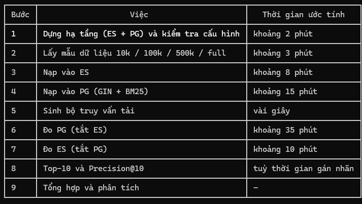

# Report

## Context

Context 1: Máy chạy benchmark

Máy host

- CPU: AMD Ryzen 5 7500F, 6 nhân/12 luồng
- RAM: 32 GB, WSL 20 GB, swap 8 GB
- Docker: Engine 29.9.3, Compose 5.7.0
- Client: Python 3.12.10, elasticsearch-py 8.15.1, psycopg2 2.9.13

Container

- Elasticsearch 8.15.3: 4 CPU, 6 GB RAM (heap 2 GB), 1 node, mỗi index 1 shard / 0 replica
- PostgreSQL 16.16 + pg_search 0.26.7 (image ParadeDB): 4 CPU, 6 GB RAM, shared_buffers 1,5 GB (25% RAM), effective_cache_size 4 GB, work_mem 32 MB, maintenance_work_mem 1 GB

Khi nạp và khi đo chỉ bật một hệ thống, hệ thống còn lại tắt để không tranh CPU/RAM.

## Data source

- Nguồn dữ liệu: Kaggle Cornell-University/arxiv, version 312 (cập nhật 15/11/2026), file 5.707.139.903 byte, 3.252.452 dòng.

Chuẩn bị tập data mẫu: từ data source tách thành các tập 10k, 100k, 500k và full (toàn bộ). Mỗi bài tính `u = crc32(id) / 2^32`, một số trong [0, 1) chỉ phụ thuộc vào id; bài thuộc tập n nếu `u < n / 3.252.452`. Nhờ vậy chạy trên máy nào cũng ra đúng cùng các tập, và các tập lồng nhau (10k ⊂ 100k ⊂ 500k ⊂ full). Cỡ tập chỉ xấp xỉ n (vd. 9.945 thay vì 10.000) vì bài được chọn theo ngưỡng chứ không cắt đúng n dòng.


**Nạp vào Elasticsearch**

```bash
docker compose --profile baseline stop postgres
docker compose up -d elasticsearch
# n = 10000 | 100000 | 500000 | 3252452  ->  size = 10k | 100k | 500k | full
python prepare_data.py index --file data/arxiv_<n>.jsonl --index arxiv_<size> --recreate
```

Thời gian nạp mỗi size

- Đã nạp 9,945 bản ghi trong 3.1s (3,204 bản ghi/s), lỗi: 0
- Đã nạp 99,961 bản ghi trong 17.9s (5,572 bản ghi/s), lỗi: 0
- Đã nạp 500,037 bản ghi trong 62.6s (7,988 bản ghi/s), lỗi: 0
- Đã nạp 3,252,452 bản ghi trong 444.0s (7,325 bản ghi/s), lỗi: 0

Kết quả tạo ra được 4 indices

```bash
curl.exe -s "http://127.0.0.1:9200/_cat/indices/arxiv_*?v&h=index,docs.count,store.size,segments.count&s=index"
index      docs.count store.size segments.count
arxiv_100k      99961    108.7mb              1
arxiv_10k        9945     11.3mb              1
arxiv_500k     500031    536.5mb              3
arxiv_full    3252359      3.3gb             22
```

`docs.deleted`: arxiv_500k = 6, arxiv_full = 93 (bằng số dòng trùng id trong file).

**Nạp vào PostgreSQL**

```bash
docker compose stop elasticsearch
docker compose --profile baseline up -d postgres
python load_postgres.py --file data/arxiv_<n>.jsonl --table papers_<size>
```

Mỗi mức dữ liệu là một bảng `papers_<size>`. Script nạp bằng `COPY`, dựng hai chỉ mục full-text, chạy `VACUUM ANALYZE`, rồi ghi thời gian và dung lượng vào `results/pg_loading.csv`. Với id trùng, script giữ bản xuất hiện sau, giống ES ghi đè theo `_id`, nên hai bên chứa cùng một tập bài (full: 3.252.359 bài).

*Các phương án truy vấn được so sánh*

| Mã | Chỉ mục | Cách khớp | Xếp hạng |
|---|---|---|---|
| `pg_fts_and` | GIN trên cột `tsv` | phải có mọi từ (AND) | `ts_rank_cd`, title nặng gấp 3 abstract |
| `pg_fts_or` | GIN trên cột `tsv` | có ít nhất một từ (OR), cùng luật khớp với ES | như trên |
| `pg_bm25` | ParadeDB (`pg_search`) | OR, `disjunction_max(title^3, abstract)`, tương đương `multi_match` của ES | BM25 (k1 = 1,2; b = 0,75) |

Cột `tsv` ghép title (trọng số A) và abstract (trọng số B) sau bộ phân tích `english` của PG (tách từ, bỏ stopword, đưa về gốc từ). Chỉ mục ParadeDB dùng tokenizer `unicode_words` kèm stemmer và stopwords tiếng Anh. Cả hai cách xử lý văn bản đều gần với analyzer `english` mà ES dùng cho title và abstract.

- **GIN**: chỉ mục đảo ngược (inverted index) có sẵn của PostgreSQL, là loại chỉ mục docs khuyên dùng cho full-text search. Mỗi từ trỏ tới danh sách vị trí dòng trong bảng, nên chỉ mục chỉ trả lời được "dòng nào khớp". Xếp hạng nằm ngoài chỉ mục: PG đọc lại tsvector của từng dòng khớp để tính `ts_rank_cd`, và hàm này không dùng thống kê toàn kho (IDF).
- **ParadeDB BM25**: chỉ mục của extension `pg_search`, lõi là Tantivy (thư viện tìm kiếm viết bằng Rust, mô phỏng Lucene). Đây cũng là chỉ mục đảo ngược, nhưng chia thành các segment như Lucene và lưu thêm tần suất từ, độ dài trường, nên tính được điểm BM25 và lấy top-K ngay trong chỉ mục.

*Lý do chọn*

- **Không dùng `LIKE`**: `LIKE '%từ%'` không dùng được chỉ mục B-tree (B-tree chỉ dùng được khi mẫu neo ở đầu chuỗi) nên phải quét toàn bảng. Nó cũng không tách từ, không đưa về gốc từ, không xếp hạng. So ES với `LIKE` chỉ cho một kết quả hiển nhiên. Code vẫn giữ `pg_like` để tham chiếu.
- **PG-FTS (GIN)**: cách làm full-text search có sẵn của PostgreSQL, không cần cài thêm, đại diện cho phương án "dùng luôn CSDL đang có". Đo cả AND (cách viết thường gặp) lẫn OR (cùng luật khớp với ES).
- **PG-BM25 (ParadeDB)**: cùng mô hình xếp hạng (BM25) và cùng kiểu cấu trúc chỉ mục với ES. Như vậy, so với ES là so "cùng thuật toán, khác hệ thống": một search engine chạy riêng và một search engine nhúng trong PostgreSQL.

*Kết quả nạp*

Thời gian (giây)

| Bảng | Số dòng | COPY | GIN | BM25 | VACUUM | Cộng các bước | Thực tế |
|---|---:|---:|---:|---:|---:|---:|---:|
| papers_10k | 9.945 | 1,88 | 0,46 | 0,95 | 0,28 | 3,6 | 4 |
| papers_100k | 99.961 | 17,11 | 5,85 | 4,16 | 0,56 | 27,7 | 28 |
| papers_500k | 500.031 | 81,16 | 24,30 | 20,76 | 1,08 | 127,3 | 128 |
| papers_full | 3.252.359 | 523,34 | 178,51 | 156,32 | 12,85 | 871,0 (14 ph 31 s) | 881 (14 ph 41 s) |
| Tổng | | | | | | 1.029,6 (17 ph 10 s) | 1.041 (17 ph 21 s) |

Dung lượng (MB)

| Bảng | Heap | GIN | BM25 | Tổng |
|---|---:|---:|---:|---:|
| papers_10k | 14,3 | 5,8 | 6,9 | 36,6 |
| papers_100k | 143,4 | 42,8 | 50,5 | 331,8 |
| papers_500k | 715,0 | 164,9 | 269,7 | 1.624,3 |
| papers_full | 4.649,8 | 777,9 | 1.744,3 | 10.256,2 |

- COPY đã gồm thời gian PG tính cột `tsv`. Cột "Thực tế" tính thêm lượt đọc file tìm id trùng và các lệnh tạo bảng, đếm dòng, đo dung lượng.
- "Tổng" dung lượng gồm heap, TOAST (giá trị dài được PG tách ra bảng phụ), khoá chính, GIN và BM25.
- Không so thẳng 871 s với 444 s của ES, vì PG dựng hai chỉ mục. Tính riêng cho `pg_bm25` (COPY + BM25 + VACUUM) là khoảng 692 s; cho `pg_fts` (COPY + GIN + VACUUM) là khoảng 715 s.
- Số liệu là của một lần đo. Lần này chậm hơn 19–38% so với một lần nạp thử trước đó trên cùng máy (ES chậm hơn 12%), nên thời gian nạp chỉ nên đọc theo bậc độ lớn.

Nguồn: PostgreSQL 16 Documentation, §11.2 *Index Types*, §12.3.3 *Ranking Search Results*, §12.9 *Preferred Index Types for Text Search*; ParadeDB docs 0.26.7, *Architecture*; S. Robertson & H. Zaragoza (2009), *The Probabilistic Relevance Framework: BM25 and Beyond*, Foundations and Trends in Information Retrieval 3(4).

## Đo truy vấn

**Bộ truy vấn tải**

```bash
python benchmark.py gen-queries --file data/arxiv_10000.jsonl --n 200
```

200 truy vấn (G0001–G0200), mỗi truy vấn là 2–4 từ nội dung liên tiếp cắt từ title của một bài ngẫu nhiên trong tập 10k (seed 42, chạy lại ra đúng file cũ). Ví dụ: G0001 `gluon contribution open heavy-meson`, G0002 `single layer`, G0034 `potential large language`, G0106 `filtervit dropoutvit`. Vì 10k nằm trong mọi tập lớn hơn, truy vấn nào cũng có ít nhất một bài khớp ở mọi mức.

**Cách đo**

```bash
bash scripts/bench_run.sh run2   # toàn bộ: PG (tắt ES) rồi ES (tắt PG), khoảng 1 giờ
# từng bước bên trong script:
python benchmark.py run --systems pg_bm25 --table papers_<size> --dataset <size> --run-id run2 --cold-start
python benchmark.py run --systems es --index arxiv_<size> --dataset <size> --run-id run2 --cold-start
python benchmark.py matches --systems pg_bm25,pg_fts_and,pg_fts_or --table papers_<size> --dataset <size>
python benchmark.py overlap
python benchmark.py summary
```

Với mỗi cặp (hệ thống, mức dữ liệu):

1. Dừng container, xả page cache của VM Docker, khởi động lại.
2. **Lượt lạnh**: chạy lần lượt 200 truy vấn, mỗi câu một lần. Top-10 của lượt này được lưu để so độ trùng (case 5).
3. **Lượt đo chính**: ở mỗi mức đồng thời 1, 4, 16, chạy 200 truy vấn × 3 lượt. Mức đồng thời = số luồng client cùng gửi truy vấn, mỗi luồng gửi câu kế tiếp ngay khi câu trước trả về (tải kiểu closed-loop).
4. Độ trễ đo phía client, tính cả mạng nội bộ và client Python. ES tắt request cache. Timeout 30 s.

Ngoại lệ: `pg_fts_or` ở mức full mỗi câu mất khoảng 8 s, chạy đủ sẽ mất khoảng 2 giờ, nên chỉ chạy 50 câu đầu (G0001–G0050), 1 lượt, đồng thời 1 và 4. Case 2 so mọi hệ thống trên đúng 50 câu này.

Lượt đo run2 chạy từ 00:29 đến 01:29 ngày 24/11, không có truy vấn nào timeout hay lỗi, nên mọi percentile là số đo thật (không phải cận dưới). Kết quả: `results/latency.csv` (tổng hợp), `results/latency_raw.csv` (từng request), `results/matches.csv`, `results/topk.csv`, `results/overlap.csv`, `results/summary_run2.md`.

**Case 1: Độ trễ và thông lượng theo kích thước dữ liệu**

Câu hỏi: khi dữ liệu tăng từ 10k lên full (gấp 327 lần), độ trễ và số truy vấn/giây (QPS) của từng hệ thống thay đổi ra sao?

Độ trễ p50 / p95 (ms), đồng thời 1

| Hệ thống | 10k | 100k | 500k | full |
|---|---:|---:|---:|---:|
| es | 3,1 / 4,4 | 3,5 / 4,9 | 3,5 / 5,0 | 5,8 / 8,5 |
| pg_bm25 | 1,6 / 2,0 | 2,3 / 3,1 | 3,1 / 5,2 | 10,0 / 14,4 |
| pg_fts_and | 0,7 / 1,1 | 1,0 / 4,2 | 1,8 / 18,2 | 28,1 / 2.207 |
| pg_fts_or | 5,1 / 26,4 | 45,3 / 227,5 | 224,2 / 479,8 | 7.838 / 14.936 (50 câu) |

QPS ở đồng thời 1 / 4 / 16

| Hệ thống | 10k | 100k | 500k | full |
|---|---:|---:|---:|---:|
| es | 330 / 1.104 / 1.113 | 289 / 940 / 1.042 | 285 / 712 / 939 | 173 / 396 / 436 |
| pg_bm25 | 631 / 2.352 / 4.203 | 419 / 1.694 / 1.758 | 293 / 1.160 / 924 | 108 / 187 / 220 |
| pg_fts_and | 1.266 / 4.623 / 8.838 | 583 / 2.083 / 2.407 | 176 / 581 / 534 | 2,0 / 4,6 / 6,9 |
| pg_fts_or | 96 / 404 / 293 | 11,9 / 41,7 / 29,4 | 4,1 / 6,2 / 5,0 | 0,1 / 0,4 / – |

Nhận xét:

- Ở mức 10k–500k, `pg_bm25` có p50 thấp hơn ES (10k: 1,6 so với 3,1 ms). Đến mức full thì ES nhanh hơn (5,8 so với 10,0 ms).
- Từ 10k lên full, p50 của ES tăng 1,9 lần, `pg_bm25` 6,4 lần, `pg_fts_and` 40 lần, `pg_fts_or` khoảng 1.500 lần.
- `pg_fts_and` có p50 thấp ở mọi mức, nhưng đuôi rất dài ở mức full: p95 2,2 s, p99 8,1 s (case 4 giải thích).
- QPS của ES tăng 2,3–3,3 lần từ đồng thời 1 lên 4, rồi gần như đứng yên từ 4 lên 16 (10k: 1.104 → 1.113). Ở mức full, ES đạt 436 QPS, `pg_bm25` đạt 220 QPS ở đồng thời 16 (p95 lần lượt 78 và 178 ms).
- Ở mức 500k, cả ba phương án PG có QPS ở đồng thời 16 thấp hơn ở đồng thời 4. `pg_fts_or` bị như vậy ở mọi mức.

Diễn giải (chưa kiểm chứng):

- ES có một chi phí cố định khoảng 3 ms mỗi request (HTTP, JSON, client Python). Ở dữ liệu nhỏ, chi phí này chiếm phần lớn thời gian, nên PG nhanh hơn. Khi dữ liệu lớn, chỉ mục của ES mở rộng tốt hơn.
- PG giảm QPS khi đồng thời 16 có thể do mỗi truy vấn khởi động tới 2 parallel worker (`max_parallel_workers_per_gather = 2`; `EXPLAIN` ở case 4 cho thấy cả truy vấn BM25 cũng dùng 2 worker). Như vậy có tới khoảng 48 tiến trình tranh 4 CPU. Có thể kiểm chứng bằng cách đo lại với `max_parallel_workers_per_gather = 0`.

Hạn chế: chưa đo CPU của container và QPS tối đa mà client Python tạo được, nên chưa biết ES dừng ở khoảng 1.100 QPS là do chính ES hay do client.

**Case 2: So trên cùng 50 truy vấn ở mức full**

Câu hỏi: vì `pg_fts_or` ở mức full chỉ chạy 50 câu, các hệ thống khác trên đúng 50 câu đó (G0001–G0050) cho số bao nhiêu? Số này tính từ log từng request (`latency_raw.csv`), đồng thời 1.

| Hệ thống | p50 (ms) | p95 (ms) | Trung bình (ms) |
|---|---:|---:|---:|
| es | 5,8 | 8,3 | 6,1 |
| pg_bm25 | 10,0 | 14,2 | 8,9 |
| pg_fts_and | 26,0 | 1.328 | 254 |
| pg_fts_or | 7.838 | 14.936 | 8.385 |

Trên cùng tập câu, `pg_fts_or` chậm hơn ES khoảng 1.350 lần (p50) và chậm hơn `pg_bm25` khoảng 790 lần, dù cả ba dùng cùng luật khớp OR.

**Case 3: Cache lạnh và cache nóng**

Câu hỏi: truy vấn ngay sau khi khởi động lại (cache trống) chậm hơn bao nhiêu so với khi đã chạy ổn định?

Cách đo: "lạnh" là lượt chạy đầu sau khi dừng container, xả page cache và khởi động lại; "nóng" là lượt đo chính ở đồng thời 1.

p50 lạnh / nóng (ms)

| Hệ thống | 10k | 100k | 500k | full |
|---|---:|---:|---:|---:|
| es | 4,5 / 3,1 | 4,9 / 3,5 | 5,3 / 3,5 | 12,0 / 5,8 |
| pg_bm25 | 2,7 / 1,6 | 4,1 / 2,3 | 6,2 / 3,1 | 15,3 / 10,0 |
| pg_fts_and | 1,3 / 0,7 | 2,9 / 1,0 | 6,4 / 1,8 | 30,1 / 28,1 |
| pg_fts_or | 5,4 / 5,1 | 47,9 / 45,3 | 229,5 / 224,2 | 7.748 / 7.838 |

Nhận xét:

- ES và `pg_bm25` chậm hơn 1,4–2,1 lần khi lạnh.
- `pg_fts_and` ở mức 500k có p95 lúc lạnh 371 ms so với 18 ms lúc nóng: các câu khớp nhiều dòng chịu ảnh hưởng nặng nhất.
- `pg_fts_or` gần như không khác giữa lạnh và nóng (1,0–1,1 lần) ở mọi mức. Diễn giải: thời gian của nó nằm ở việc xử lý từng dòng khớp chứ không ở việc đọc chỉ mục. Ở mức full, bảng khoảng 10 GB lớn hơn RAM 6 GB của container nên mỗi truy vấn vẫn phải đọc đĩa, cache không bao giờ "nóng" (xem `EXPLAIN` ở case 4).

Hạn chế: lượt lạnh chạy tuần tự nên câu sau được hưởng cache do câu trước nạp, tức là "lạnh" ở đây là "lượt đầu sau khởi động", không phải mỗi câu đều lạnh hoàn toàn. Cache ổ đĩa ảo phía Windows không kiểm soát được (chưa xác minh). Lượt lạnh của ES còn gồm thời gian JVM khởi động và tối ưu mã.

**Case 4: Độ trễ theo số bài khớp**

Câu hỏi: độ trễ phụ thuộc thế nào vào số bài khớp truy vấn?

Cách đo: `benchmark.py matches` đếm số bài khớp của từng câu, chạy riêng sau lượt đo. Ghép với độ trễ trung vị của từng câu (đồng thời 1) và tính tương quan hạng Spearman (ρ).

Số bài khớp

| Mức | OR, trung vị (es / pg_bm25 / pg_fts_or) | OR, lớn nhất (es / pg) | AND, trung vị (pg_fts_and) |
|---|---:|---:|---:|
| 10k | 1.213 / 1.226 / 1.224 | 5.842 / 5.458 | 1 |
| 100k | 11.957 / 12.252 / 11.988 | 58.895 / 55.104 | 6 |
| 500k | 60.310 / 61.453 / 60.426 | 294.205 / 275.402 | 26 |
| full | 391.966 / 398.024 / 392.480 | 1.909.832 / 1.788.031 | 174 |

Độ trễ trung vị theo nhóm số bài khớp, mức full (số câu trong ngoặc)

| Hệ thống | < 1k | 1k–10k | 10k–100k | ≥ 100k | ρ |
|---|---:|---:|---:|---:|---:|
| es | 3,9 ms (3) | 4,0 ms (3) | 4,8 ms (21) | 5,8 ms (173) | 0,61 |
| pg_bm25 | 2,0 ms (3) | 2,0 ms (3) | 3,4 ms (21) | 10,4 ms (173) | 0,97 |
| pg_fts_and | 15,8 ms (138) | 346 ms (38) | 1.685 ms (21) | 10.264 ms (3) | 0,95 |
| pg_fts_or (50 câu) | – | 384 ms (2) | 5.233 ms (6) | 9.329 ms (42) | −0,16 |

Ở mức 10k–500k, ρ của `pg_fts_or` là 0,95–0,97: độ trễ gần như do số bài khớp quyết định. Ở mức full, ρ = −0,16 không có ý nghĩa vì 42/50 câu đều khớp trên 100k bài.

Ví dụ cụ thể (mức full, độ trễ trung vị, đồng thời 1)

| Truy vấn | Số bài khớp | es | pg_bm25 | pg_fts_and | pg_fts_or |
|---|---|---:|---:|---:|---:|
| G0034 `potential large language` | OR khoảng 906 nghìn (28% kho); AND 16.947 | 6,7 ms | 13,7 ms | 1.365 ms | 5.532 ms |
| G0168 `very strong` | AND 308.306 | 4,7 ms | 10,2 ms | 10.264 ms | (ngoài 50 câu) |
| G0106 `filtervit dropoutvit` | 1 | 3,9 ms | 2,1 ms | 1,6 ms | (ngoài 50 câu) |

Bằng chứng từ `EXPLAIN (ANALYZE, BUFFERS)` trên `papers_full` (chạy sau lượt đo):

| Truy vấn | Cách PG thực thi | Trang đọc từ đĩa | Thời gian |
|---|---|---:|---:|
| FTS-OR `potential or large or language` | Quét tuần tự toàn bảng (Parallel Seq Scan), **không dùng GIN** vì planner ước tính khoảng 821 nghìn dòng khớp; JIT 259 ms | 976.574 (khoảng 7,5 GB) | 5,3 s |
| FTS-AND `very strong` | GIN tìm dòng khớp (78 trang), rồi đọc 308 nghìn dòng từ heap để xếp hạng | 425.973 | – |
| BM25 `potential large language` | Custom scan ParadeDB, `TopKScanExecState`, chỉ lấy 10 dòng từ heap | 487 | 48 ms |

Thời gian chỉ để **đếm** số bài khớp của 200 câu ở mức full: es 1,0 s, `pg_bm25` 2,8 s, `pg_fts_and` 52 s, `pg_fts_or` 1.148 s.

Nhận xét:

- Với FTS, bản thân GIN rất rẻ (78 trang). Chi phí nằm ở chỗ phải đọc **từng dòng khớp** từ bảng để tính `ts_rank_cd`, đúng như docs PostgreSQL cảnh báo (§12.3.3). Khi số dòng khớp quá lớn, planner bỏ luôn GIN và quét cả bảng, nên `pg_fts_or` ở mức full mất 5–15 s mỗi câu.
- ES và `pg_bm25` lấy top-10 ngay trong chỉ mục, nên độ trễ chỉ tăng nhẹ theo số bài khớp: ở nhóm ≥ 100k bài, ES 5,8 ms và `pg_bm25` 10,4 ms, so với `pg_fts_or` 9,3 s.
- Số bài khớp của ES, `pg_bm25` và `pg_fts_or` gần như bằng nhau (trung vị ở mức full: 391.966 / 398.024 / 392.480), xác nhận ba bên cùng luật khớp OR. Chênh lệch lớn nhất nằm ở các từ bị đưa về gốc khác nhau (case 5).
- JIT của PG (bật mặc định khi chi phí ước tính vượt 100.000) chỉ chiếm khoảng 5% thời gian câu FTS-OR ở trên, không phải nguyên nhân chính.

**Case 5: Độ trùng top-10 giữa các hệ thống**

Câu hỏi: các hệ thống có trả về cùng những bài, theo cùng thứ tự không? Đo bằng RBO (rank-biased overlap, p = 0,9): 1 là trùng hoàn toàn và cùng thứ tự, 0 là không có bài chung. Chỉ tính các câu mà cả hai hệ thống đều trả đủ 10 bài (số câu trong ngoặc khi khác 196–199).

| Cặp | 10k | 100k | 500k | full |
|---|---:|---:|---:|---:|
| es ~ pg_bm25 | 0,984 | 0,928 | 0,895 | 0,897 |
| es ~ pg_fts_or | 0,352 | 0,202 | 0,113 | 0,052 (50 câu) |
| es ~ pg_fts_and | 0,399 (47 câu) | 0,370 (90) | 0,298 (120) | 0,243 (154) |
| pg_bm25 ~ pg_fts_or | 0,352 | 0,204 | 0,114 | 0,050 (50 câu) |

Nhận xét:

- `pg_bm25` gần như tái hiện thứ hạng của ES (RBO 0,90–0,98). FTS cho thứ hạng khác hẳn, và càng khác khi dữ liệu càng lớn. Diễn giải: `ts_rank_cd` không dùng IDF nên từ phổ biến và từ hiếm được tính ngang nhau.
- Một nguyên nhân khiến ES và `pg_bm25` không trùng hoàn toàn, **đã kiểm tra bằng thực nghiệm**: hai bên đưa từ về gốc khác nhau. Analyzer `english` của ES đưa `generative`, `general`, `generation` về cùng một gốc `gener`; PG (cả FTS lẫn tokenizer của ParadeDB) tách thành `generat` và `general`. Vì vậy truy vấn G0161 `quantile networks generative modeling` khớp 1.909.832 bài trên ES nhưng chỉ 1.605.981 bài trên `pg_bm25`. Theo mình hiểu, ES dùng thuật toán Porter còn PG dùng Snowball English, nhưng điểm này chưa đối chiếu lại với docs. Các nguyên nhân khác như cách mã hoá độ dài trường hay thứ tự các bài cùng điểm chưa kiểm tra.

Hạn chế: RBO chỉ đo hai hệ thống giống nhau đến đâu, không đo bài trả về có liên quan hay không. Độ liên quan cần gán nhãn (bước 8).

**Case 6: Độ ổn định giữa hai lượt đo**

Câu hỏi: đo lại thì số có giống không? So run1 (23/11, không khởi động lại trước mỗi hệ thống) với run2, p50 ở đồng thời 1 (ms). Run1 chỉ có PG.

| Hệ thống | 10k | 100k | 500k | full |
|---|---:|---:|---:|---:|
| pg_bm25 | 1,62 → 1,55 | 2,31 → 2,33 | 3,14 → 3,07 | 10,09 → 9,97 |
| pg_fts_and | 0,72 → 0,71 | 0,96 → 0,95 | 1,70 → 1,81 | 27,0 → 28,1 |
| pg_fts_or | 4,79 → 5,05 | 45,2 → 45,3 | 226,8 → 224,2 | 7.483 → 7.838 |

Hai lượt lệch nhau tối đa khoảng 7%, ổn định hơn nhiều so với thời gian nạp (lệch 12–38%). Run1 của `pg_fts_or` ở mức full có thể bị chen bởi một câu `count(*)` chạy song song trong lúc đo.

**Hạn chế chung**

- Một máy, một node, một shard. Client Python chạy cùng máy với Docker.
- Truy vấn là mẩu cắt từ title (2–4 từ), không đại diện cho mọi kiểu truy vấn thực tế.
- Cột `docs` của PG trong `latency.csv` (run2) ở mức 500k và full là số ước lượng của `ANALYZE` (500.205 và 3.250.552); số thật là 500.031 và 3.252.359. Code đã sửa để đếm chính xác sau khi đo, áp dụng cho các lượt sau.

Nguồn: PostgreSQL 16 Documentation, §12.3.3 *Ranking Search Results*, §20.7 *Query Planning* (`jit_above_cost`); ParadeDB docs 0.26.7, *Top K*; W. Webber, A. Moffat & J. Zobel (2010), *A Similarity Measure for Indefinite Rankings*, ACM TOIS 28(4); B. Schroeder, A. Wierman & M. Harchol-Balter (2006), *Open Versus Closed: A Cautionary Tale*, NSDI.

# Plan


